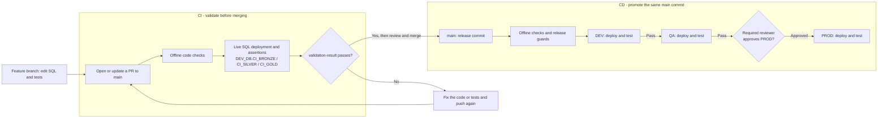
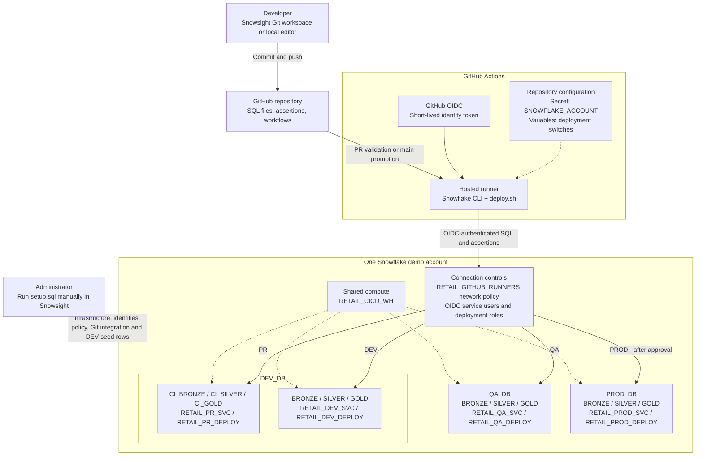

# Snowflake SQL CI/CD Demo

- **Stack:** GitHub Actions, Snowflake CLI, OIDC, and plain SQL. No migration framework.
- **Release path:** Same commit through DEV -> QA -> manual approval -> PROD.
- **Layout:** One account; `DEV_DB`, `QA_DB`, and `PROD_DB`; `BRONZE`, `SILVER`, and `GOLD` in each.

**Overview:** [CI/CD flow](#how-cicd-works-in-this-demo) | [Demo architecture](#demo-architecture)

**Follow these steps in order:**
[1. Prepare](#1-prepare) | [2. Run setup](#2-run-setup-in-snowsight) | [3. Connect Git](#3-connect-snowsight-to-github) | [4. Configure Actions](#4-configure-github-actions) | [5. Deploy](#5-deploy-and-verify) | [6. Make a change](#6-make-a-change)

## How CI/CD works in this demo

- **CI:** Validate SQL changes in a pull request before merging.
- **CD:** Deploy from `main` to DEV and QA; approve PROD manually.

- DEV, QA, and PROD are **environments, not branches**; all deploy from `main`.
- PR tests use separate CI schemas, not regular DEV layers.
- Failed deployments stop promotion. Require `validation-result` to block failed PRs.
- Fork and Dependabot PRs are offline-only and cannot pass `validation-result`.
- Diagrams show the intended enabled flow, **not live execution evidence**. Enable deployments in step 4.

## Demo architecture

- **Solid arrows:** Code submission and target routing. **Dotted arrows:** Configuration, setup, and compute.
- **Promotion moves code, not data.** Each target uses its own database, schemas, and role.
- Deployment tests reruns and data preservation; the demo task stays suspended.
- Manual setup and interactive Git sign-in are separate from Actions deployment.

## 1. Prepare

- Use a dedicated demo account and a private GitHub repository with Actions enabled.
- Arrange administrator access for setup and a reviewer for production approval.
- Before publishing workflows, create repository variables `DEPLOYMENTS_ENABLED=false` and `PROD_ENABLED=false` under **Settings > Secrets and variables > Actions > Variables**.
- For another account/repository, update account guards, repository IDs, OIDC subjects, Git URL, and reviewer ID across SQL, scripts, and tests.
- Edit `setup.sql` directly. No generator or local Python setup is required.

## 2. Run setup in Snowsight

- Copy **[setup.sql](setup.sql)** into Snowsight using a login with ACCOUNTADMIN access.
- Run its nine numbered sections in order. **Section 1:** confirm account and object names. **Section 6:** review policies before `ALTER USER`.
- This one file includes infrastructure, DEV sample rows, OIDC users, runner policy attachments, and Git integration. Do not run the separate reference scripts.
- **Safety:** Checks are manual. Review existing network restrictions with an administrator; stop on errors. Existing user/integration settings are not reconciled.
- **PROD:** Created disabled; an existing user's disabled state is unchanged.
- **Verify:** Every statement succeeds; fresh setup shows **4 customers and 11 orders**. The final status message alone does not prove success.
- Full business deployment runs through Actions, not manual setup.

## 3. Connect Snowsight to GitHub

- Publish `main` with deployments still disabled.
- In Snowsight's user menu, select `RETAIL_DEV_DEPLOY`.
- Open **Projects > Workspaces > From Git repository**.
- Enter the repository URL; select `RETAIL_GITHUB_APP`.
- Choose **OAuth2**, complete GitHub sign-in, and create the workspace.

## 4. Configure GitHub Actions

Use repository owner/admin access for these settings.

### A. Create the three environments

- Open **Settings > Environments > New environment**; create `dev`, `qa`, and `prod`.
- In each, choose **Deployment branches and tags > Selected branches and tags**.
- Add exactly one rule: **Branch > `main`**. No tags or wildcards.
- Leave required reviewers off for DEV and QA.

### B. Require approval for PROD

- Open **Settings > Environments > prod > Deployment protection rules**.
- Enable **Required reviewers** and select the approver.
- Deselect **Allow administrators to bypass configured protection rules**; save.
- Match the approver's numeric GitHub ID in both checks in [`scripts/check_environment.py`](scripts/check_environment.py) and the offline test.
- **Team:** Enable **Prevent self-review**. **Solo demo:** Allow self-review.
- **Gate unavailable?** Keep `PROD_ENABLED=false`; check [GitHub availability](https://docs.github.com/en/actions/how-tos/deploy/configure-and-manage-deployments/manage-environments). Do not bypass approval.

### C. Check the deployment switches

**Account secret**

- Open **Settings > Secrets and variables > Actions > Secrets > New repository secret**.
- **Name:** `SNOWFLAKE_ACCOUNT`.
- **Value:** Demo account identifier, `ORGANIZATION-ACCOUNT` -- not a URL or Snowhouse account.
- Click **Add secret**. Use repository scope; do not add same-name environment secrets.
- PR and promotion workflows use this secret; missing/blank values fail before authentication.
- The value must match account guards in `scripts/deploy.sh` and `sql/00_guard.sql`. The secret does not remove identifiers elsewhere in the repo/history.

**Deployment variables**

- Open **Settings > Secrets and variables > Actions > Variables > New repository variable**.
- **`DEPLOYMENTS_ENABLED=false` initially:** Set to `true` after verifying setup, grants, and network configuration. Enables live PR tests and DEV/QA.
- **`PROD_ENABLED=false` initially:** Set to `true` only after verifying the reviewer gate and explicitly enabling `RETAIL_PROD_SVC` in Snowsight.
- Use lowercase `true`/`false`. Changing variables does not trigger a run.
- DEV/QA can run with PROD disabled; the workflow then reports **`PROD BLOCKED`**, not a complete release.

### D. Protect the main branch

- Open **Settings > Branches**; add a protection rule for `main`.
- Require PRs and the **`validation-result`** status check; block force pushes and deletion.
- Check not listed? Open a test PR, let **Retail PR validation** run, then select it.
- Failed or skipped live SQL makes `validation-result` fail. Enable live tests before merging.

**Full-release checklist**

- [ ] Account secret added; manual setup verified.
- [ ] All three environments restricted to branch `main`.
- [ ] PROD reviewer saved; administrator bypass disabled.
- [ ] Production service user enabled; both deployment variables set to `true`.

## 5. Deploy and verify

- Open **Actions > Retail SQL promotion > Run workflow**; select `main`.
- Review DEV and QA deployment/test results.
- Approve PROD through **Review deployments** using the designated reviewer.
- Run **[verify.sql](verify.sql)** with the matching environment role/database.
- **Expected order 101:** $200 gross, $20 discount, $180 net.
- Confirm the same release commit across all targets and a suspended task.

## 6. Make a change

- Create a feature branch; edit business SQL in [`sql/`](sql/).
- Update expected results in [`tests/assertions.sql`](tests/assertions.sql).
- Push and open a PR to `main`; review passing checks before merging.
- Follow DEV -> QA promotion, approve PROD, and verify results.

**Example: GOLD discount from 10% to 15%**

- Expected discounts: `20 -> 30` and `10 -> 15`.
- Expected net amounts: `180 -> 170` and `90 -> 85`.
- Expected total net sales: `519.99 -> 504.99`.

## Documentation

- [Snowflake CLI GitHub Action and OIDC](https://docs.snowflake.com/en/developer-guide/snowflake-cli/cicd/github-action)
- [Connect Snowsight Workspaces to Git](https://docs.snowflake.com/en/user-guide/ui-snowsight/workspaces-git)
- [GitHub deployment environments and approval rules](https://docs.github.com/en/actions/how-tos/deploy/configure-and-manage-deployments/manage-environments)

> Offline checks are not live deployment evidence. Verify the expected results through Actions before presenting an end-to-end success.
