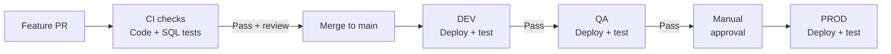
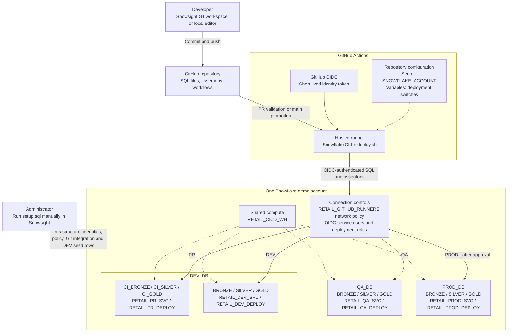

# Snowflake SQL CI/CD Demo

Retail SQL deployment using **GitHub Actions, Snowflake CLI, and OIDC**. No migration framework.

[Setup](#1-run-setup) · [Connect Git](#2-connect-git) · [Configure Actions](#3-configure-github-actions) · [Deploy](#4-deploy-and-verify) · [Make a change](#5-make-a-change)

## How CI/CD works in this demo

- **CI:** Test PR changes in isolated CI schemas; fix failures and push again.
- **CD:** Promote the same `main` commit through DEV, QA, and approved PROD. Failed stages stop promotion.
- Environments are not branches. Promotion moves code, not data.

<strong>Demo architecture</strong>

## 1. Run setup

- Use a dedicated demo account, administrator access, and a private GitHub repository.
- Before publishing workflows, set repository variables `DEPLOYMENTS_ENABLED=false` and `PROD_ENABLED=false` (step 3).
- Run **[setup.sql](setup.sql)** in Snowsight. No Python setup or separate setup scripts needed.
- **Pause for manual checks:** Section 1 confirms the account; section 6 reviews network policies before attachment. Stop on errors; reused settings are not reconciled.
- Verify all statements succeeded and fresh setup shows **4 customers / 11 orders**. Full deployment happens through Actions.

**Using another account/repo?** Update account guards, repository IDs, OIDC subjects, Git URL, and reviewer ID in SQL, scripts, and tests. Changing the GitHub secret alone is not enough.

## 2. Connect Git

- Publish `main` with deployments disabled.
- In Snowsight's user menu, select `RETAIL_DEV_DEPLOY`.
- Open **Projects > Workspaces > From Git repository**.
- Enter the repository URL, select `RETAIL_GITHUB_APP`, and complete **OAuth2** sign-in.

## 3. Configure GitHub Actions

### Account secret and deployment variables

Open **Settings > Secrets and variables > Actions**:

- **Secrets > New repository secret:** Add `SNOWFLAKE_ACCOUNT` = your demo `ORGANIZATION-ACCOUNT` identifier, not a URL. Do not add same-name environment secrets.
- **Variables > New repository variable:** Add both switches below, initially `false`.
- **`DEPLOYMENTS_ENABLED`:** Set to `true` after setup, grants, and network checks. Enables live PR tests and DEV/QA.
- **`PROD_ENABLED`:** Set to `true` only after configuring approval below and explicitly enabling `RETAIL_PROD_SVC` in Snowsight. Setup creates this user disabled; reruns preserve its existing state.

### Environments and approval

- **Settings > Environments:** Create `dev`, `qa`, and `prod`.
- For each, select **Deployment branches and tags > Selected branches and tags**; add only **Branch: `main`**.
- For **prod**, enable **Required reviewers**, select the approver, disable administrator bypass, and save. Leave DEV/QA reviewers off.
- Match the approver's numeric ID in both checks in [`check_environment.py`](scripts/check_environment.py) and its offline test.
- Teams: enable **Prevent self-review**. Solo demo: allow self-review.
- **Reviewer gate unavailable?** Keep PROD disabled; check [GitHub requirements](https://docs.github.com/en/actions/how-tos/deploy/configure-and-manage-deployments/manage-environments).

### Protect main

- **Settings > Branches:** Require PRs and **`validation-result`**; block force pushes and deletion.
- Check not listed? Run a test PR first. Failed/skipped live SQL cannot pass; fork and Dependabot PRs are offline-only.

## 4. Deploy and verify

- Open **Actions > Retail SQL promotion > Run workflow > main**. Variable changes alone do not start a run.
- Review DEV/QA results, then approve PROD through **Review deployments**.
- Run **[verify.sql](verify.sql)**: after deploying this 15% change, order 101 should show **$200 gross / $30 discount / $170 net** (10% baseline: $20 discount / $180 net); confirm matching release commits and a suspended task.
- With PROD disabled, DEV/QA can run, but the workflow reports **`PROD BLOCKED`** rather than full-release success.

## 5. Make a change

- Create a feature branch; edit [`sql/`](sql/) and [`tests/assertions.sql`](tests/assertions.sql).
- Push, open a PR to `main`, review passing checks, and merge. Follow promotion and approve PROD.
- **Example: 10% -> 15% discount.** Expected discounts: `20 -> 30`, `10 -> 15`; net amounts: `180 -> 170`, `90 -> 85`; total: `519.99 -> 504.99`.

## Documentation

- [Snowflake CLI and OIDC](https://docs.snowflake.com/en/developer-guide/snowflake-cli/cicd/github-action)
- [Snowsight Git setup](https://docs.snowflake.com/en/user-guide/ui-snowsight/workspaces-git)
- [GitHub environments](https://docs.github.com/en/actions/how-tos/deploy/configure-and-manage-deployments/manage-environments)

> Diagrams and sample results describe the intended flow. Offline checks do not prove live deployment success.
