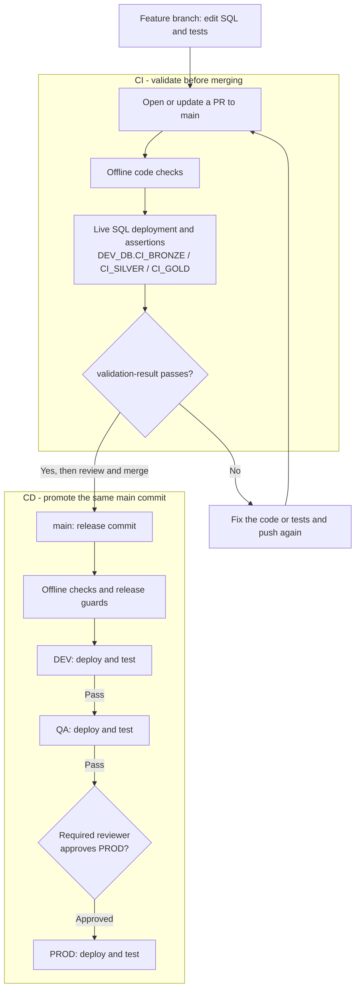
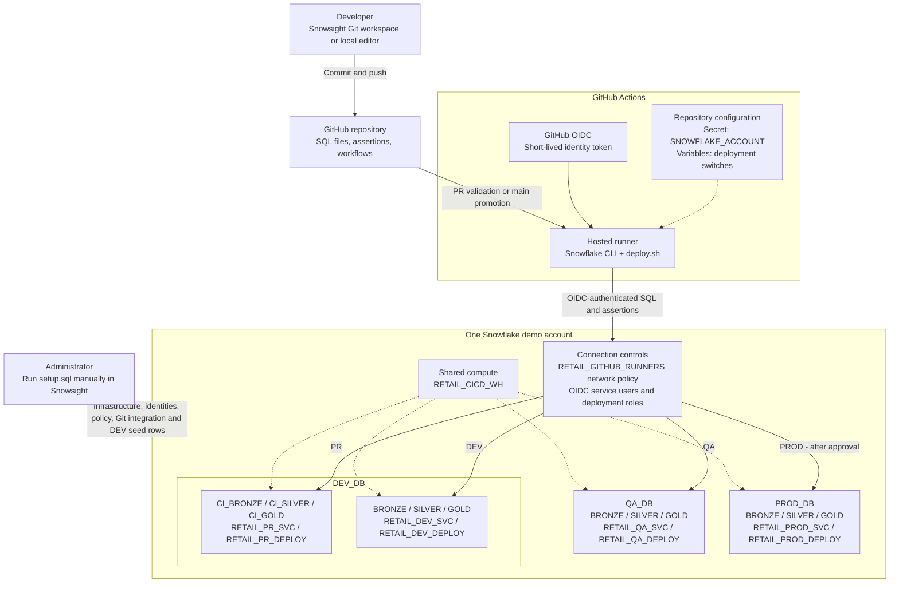

# Snowflake SQL CI/CD Demo

Deploy a retail SQL example with **GitHub Actions, Snowflake CLI, and OIDC**. The same code revision moves through **DEV -> QA -> manual approval -> PROD**. No migration framework is used.

The demo defines `DEV_DB`, `QA_DB`, and `PROD_DB` in one account, each with `BRONZE`, `SILVER`, and `GOLD` schemas.

**Overview:** [CI/CD flow](#how-cicd-works-in-this-demo) | [Demo architecture](#demo-architecture)

**Follow these steps in order:**
[1. Prepare](#1-prepare) | [2. Run setup](#2-run-setup-in-snowsight) | [3. Connect Git](#3-connect-snowsight-to-github) | [4. Configure Actions](#4-configure-github-actions) | [5. Deploy](#5-deploy-and-verify) | [6. Make a change](#6-make-a-change)

## How CI/CD works in this demo

**Continuous integration (CI)** checks proposed SQL changes before merging. **Continuous delivery (CD)** deploys the merged code through DEV and QA, then waits for production approval. GitHub Actions orchestrates the work; Snowflake CLI submits the SQL and assertions.

DEV, QA, and PROD are **environments, not Git branches**. PR validation uses separate CI schemas; it does not deploy to the regular DEV layers. A failed deployment stops later stages. Require `validation-result` in branch protection to enforce the PR check before merging.

The diagram shows the **enabled path**, not proof of a completed deployment. Live PR tests and DEV/QA require `DEPLOYMENTS_ENABLED=true`; PROD also requires `PROD_ENABLED=true`, an enabled service user, and a configured reviewer gate. Fork and Dependabot PRs skip live SQL and do not receive a passing `validation-result`.

## Demo architecture

Solid arrows show code submission and target routing; dotted arrows show configuration, manual provisioning, or compute usage. **Promotion moves code, not data between databases.** Each target runs the same ordered SQL files with its own database, schemas, and role. The deployment tests reruns and data preservation, and leaves the demo task suspended.

Snowsight's interactive Git connection is separate from Actions authentication. As the [Snowflake CLI documentation](https://docs.snowflake.com/en/developer-guide/snowflake-cli/cicd/github-action) states, with OIDC, "GitHub issues a short-lived OpenID Connect token that Snowflake validates directly."

## 1. Prepare

- Use a dedicated demo account and a private GitHub repository with Actions enabled.
- Arrange administrator access for setup and a reviewer for production approval.
- Before publishing workflows, create repository variables `DEPLOYMENTS_ENABLED=false` and `PROD_ENABLED=false` under **Settings > Secrets and variables > Actions > Variables**.
- If using a different account or repository, update the account/user guards, repository identifiers, OIDC subjects, Git URL, and reviewer ID in the supplied SQL, scripts, workflows, and tests. These values are not automatically configured by this README. Edit `setup.sql` directly; no generator or local Python setup is required.

## 2. Run setup in Snowsight

Open **[setup.sql](setup.sql)** and copy it into a Snowsight SQL worksheet using a login with ACCOUNTADMIN access. The file uses plain SQL in nine numbered sections—no scripting blocks.

Run section 1 first to confirm the intended account and existing object names. Continue in order, pausing in section 6 to inspect existing network policies before executing its `ALTER USER` statements. Stop on any error.

This single file includes roles, warehouse, DEV/QA/PROD schemas, DEV sample rows, all four OIDC identities, the GitHub runner network policy **and its user attachments**, and the Snowsight Git integration. No other SQL setup file is needed. `setup.sql` is the authoritative setup file. Do not run the separate OIDC/Git/network reference scripts as additional setup steps.

**Checks are manual, not automatic safeguards.** A user-level network policy overrides the account-level policy ([documentation](https://docs.snowflake.com/en/user-guide/network-policies#network-policy-precedence)); have an administrator review any existing restrictions before attaching this one. The script only attaches the policy to the four automation users. It creates PROD disabled and never enables it; an existing PROD user's disabled state is unchanged. Existing user/integration settings are not reconciled.

**Check:** Inspect every statement result and verify **4 customers / 11 orders** on a fresh setup. The final status message alone does not prove success. Full business deployment still happens through Actions. Git sign-in and GitHub approval settings are completed in steps 3 and 4.

## 3. Connect Snowsight to GitHub

Publish the project to your repository's `main` branch with deployments still disabled. Then, in Snowsight:

1. Select `RETAIL_DEV_DEPLOY` in the user-menu role selector.
2. Open **Projects > Workspaces > From Git repository**.
3. Enter your repository URL and select `RETAIL_GITHUB_APP`.
4. Choose **OAuth2**, complete GitHub sign-in, and create the workspace.

This Git connection is separate from the OIDC authentication used by Actions. See the [workspace setup documentation](https://docs.snowflake.com/en/user-guide/ui-snowsight/workspaces-git).

## 4. Configure GitHub Actions

Complete these settings **in your GitHub repository**, using repository owner/admin access. GitHub environments control where a workflow may run; they are not the DEV/QA/PROD databases.

### A. Create the three environments

1. Open **Settings > Environments > New environment**. Enter `dev` and click **Configure environment**. If it already exists, open it instead.
2. Under **Deployment branches and tags**, choose **Selected branches and tags**.
3. Click **Add deployment branch or tag rule**, select **Branch**, enter `main`, and save. Keep exactly this one rule; do not add a tag rule or wildcard.
4. Repeat for `qa` and `prod`. Leave required reviewers off for DEV and QA so those stages can run automatically.

### B. Require approval for PROD

1. Open **Settings > Environments > prod**.
2. Under **Deployment protection rules**, select **Required reviewers** and add the person who will approve production releases.
3. Deselect **Allow administrators to bypass configured protection rules**, then click **Save protection rules**.
4. Use the same person's numeric GitHub user ID in both reviewer checks in [`scripts/check_environment.py`](scripts/check_environment.py), and update the matching offline test if changing the reviewer. This script checks both the configured reviewer and who actually approved the run.

For a team deployment, select **Prevent self-review** and use a different person to approve. For a solo demonstration, leave self-review allowed so the person starting the run can approve it.

**If Required reviewers is missing or cannot be saved, stop here for PROD.** Check [GitHub's availability requirements](https://docs.github.com/en/actions/how-tos/deploy/configure-and-manage-deployments/manage-environments). Creating an environment or clicking Run workflow does not establish an approval gate. Keep `PROD_ENABLED=false` until the gate is available and verified.

### C. Check the deployment switches

**First, add the account identifier as a repository secret:**

1. Open **Settings > Secrets and variables > Actions > Secrets**.
2. Click **New repository secret**.
3. Name it **`SNOWFLAKE_ACCOUNT`** and enter the identifier for the demo account where you ran `setup.sql`, in `ORGANIZATION-ACCOUNT` form. Do not enter a URL or your Snowhouse account.
4. Click **Add secret**. Use a repository secret, not an environment secret, so the PR workflow can use it too. Do not create same-name environment secrets.

The PR workflow reads this secret directly; the promotion workflow passes it explicitly to DEV, QA, and PROD. Missing or blank values fail before requesting an OIDC token. The account identifier is configuration, not an authentication credential; a secret is used here to keep it out of workflow YAML. The [official OIDC example](https://docs.snowflake.com/en/developer-guide/snowflake-cli/cicd/github-action) uses `${{ secrets.SNOWFLAKE_ACCOUNT }}`. No password or private-key secret is needed for this OIDC configuration.

The account must still match the deliberate safety checks in `scripts/deploy.sh` and `sql/00_guard.sql`. Changing the secret alone does not retarget the entire demo or remove account identifiers already present elsewhere in the repository/history.

**Then configure the deployment switches:**

Open **Settings > Secrets and variables > Actions > Variables**. These are **repository variables**, not secrets or environment variables. Add them with **New repository variable**, or edit the existing values:

- **`DEPLOYMENTS_ENABLED`**: start with `false`. Set to `true` only after verifying manual setup, grants, and network configuration. This enables live PR SQL checks and DEV/QA promotion on subsequent runs.
- **`PROD_ENABLED`**: keep `false` until section B is complete and verified. Then explicitly enable the initially disabled `RETAIL_PROD_SVC` identity in Snowsight and set this variable to `true`.

Use lowercase `true` and `false`. Changing a variable does not start a workflow; start a new run in step 5. With DEV/QA enabled but PROD disabled, the workflow intentionally reports `PROD BLOCKED` after QA rather than claiming a complete release.

### D. Protect the main branch

In **Settings > Branches**, add or edit a branch protection rule for `main`. Require a pull request and passing status checks before merging; keep force pushes and branch deletion disabled.

Select **`validation-result`** as a required status check. If it is not listed yet, open a test PR and let **Retail PR validation** run, then return to select the check. Its exact name is visible in the PR's **Checks** tab. It intentionally fails if live SQL tests fail or are skipped; enable live validation and get a passing result before merging.

**Ready for step 5:** All three environments have a single `main` branch rule, PROD has a saved reviewer gate with bypass disabled, both enable switches are `true`, and the production identity has been explicitly enabled. Do not change these settings just to bypass a failed check.

## 5. Deploy and verify

1. In GitHub, open **Actions > Retail SQL promotion > Run workflow** and select `main`.
2. Inspect the DEV deployment and tests, followed by QA.
3. Have the designated reviewer approve PROD through **Review deployments**.
4. Run **[verify.sql](verify.sql)** in Snowsight using the matching environment role/database.

**Expected result:** Order 101 has **$200 gross, $20 discount, and $180 net**. Confirm the same release commit across DEV, QA, and PROD. The task should remain suspended.

## 6. Make a change

1. Create a feature branch and update the business SQL in [`sql/`](sql/).
2. Update the matching assertions in [`tests/assertions.sql`](tests/assertions.sql).
3. Push the branch and open a pull request to `main`.
4. Review the changes and passing checks, then merge.
5. Follow the automatic DEV -> QA promotion, approve PROD, and verify the new results.

**Example:** Change the GOLD discount from 10% to 15%. Update expected discounts **20 -> 30** and **10 -> 15**, net amounts **180 -> 170** and **90 -> 85**, and total net sales **519.99 -> 504.99**. Order 101 should then have **$170 net**.

## Documentation

- [Snowflake CLI GitHub Action and OIDC](https://docs.snowflake.com/en/developer-guide/snowflake-cli/cicd/github-action)
- [Connect Snowsight Workspaces to Git](https://docs.snowflake.com/en/user-guide/ui-snowsight/workspaces-git)
- [GitHub deployment environments and approval rules](https://docs.github.com/en/actions/how-tos/deploy/configure-and-manage-deployments/manage-environments)

Sample results above are expectations. Passing offline checks does not verify live SQL execution; complete the deployment steps before presenting the demo as tested end to end.
